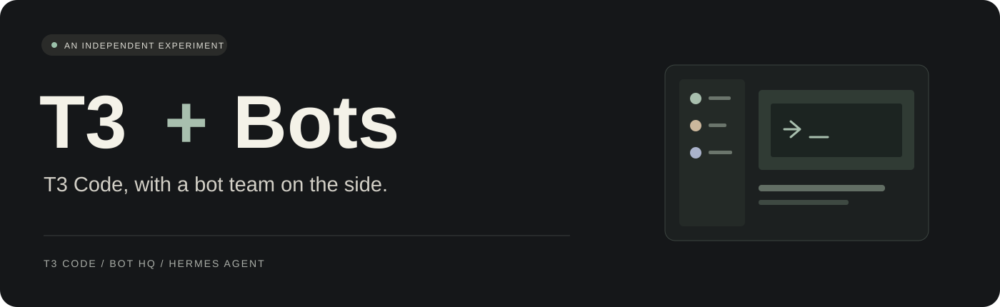
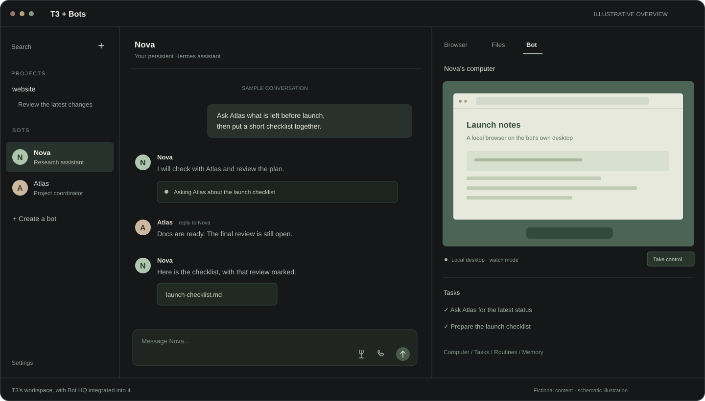
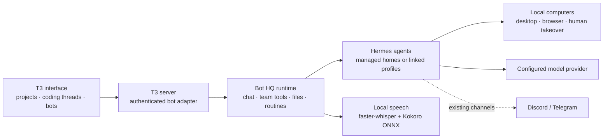

<p align="center">
  
</p>

<p align="center"><strong>The T3 interface we like. A bot experiment we thought was cool.</strong></p>

<p align="center">
  <a href="https://github.com/zznorthstar/t3-bots/actions/workflows/ci.yml"></a>
  <a href="LICENSE"></a>
  
  
</p>

<p align="center">
  <a href="#try-it">Try it</a> · <a href="docs/user/bots.md">Bot guide</a> · <a href="docs/operations/build-bots-desktop.md">Build the desktop</a> · <a href="https://github.com/zznorthstar/t3-bots/releases">Releases</a> · <a href="https://github.com/zznorthstar/t3-bots/issues">Feedback</a>
</p>

**T3 + Bots is an independent, experimental fork of [T3 Code](https://github.com/pingdotgg/t3code) with [Bot HQ](https://github.com/nickvasilescu/bot-hq) integrated into its interface.** T3 supplies the app, coding workflow, UI and UX. Bot HQ supplies the bot team. [Hermes Agent](https://github.com/NousResearch/hermes-agent) runs the assistants and their computers.

Create a bot from T3's left sidebar. Chat with it in the main view. Open the **Bot** tab on the right to see its computer, tasks, routines and memory. Your coding projects and agent threads stay in the same application.

## Why a separate repo?

We like T3 as it is. We don't believe a persistent bot team is necessarily valuable to most T3 users, or a good addition to the core product. We are not proposing this as a feature for upstream T3.

We just thought it was cool, wanted it for our own workflow, and decided to share it. That's the whole pitch.

This is **T3 with an extra feature**, not a claim that we invented T3, Bot HQ, or a better version of either. It is not an official T3 release and is not affiliated with or endorsed by their maintainers. If you want regular T3, [get it from T3](https://t3.codes/download).

## What the extra feature does

| Feature                           | What you get                                                                                                                                                                       |
| --------------------------------- | ---------------------------------------------------------------------------------------------------------------------------------------------------------------------------------- |
| **Bots inside T3**                | Create persistent assistants beside projects and coding threads. Use T3's existing panels and navigation.                                                                          |
| **A local computer per bot**      | Separate Hermes desktops and browser profiles on your Linux machine. Watch live, take control, then hand it back. No Orgo account needed for this backend.                         |
| **A team that can talk**          | Bots can ask one another questions and participate in group conversations. Agent replies show the agent's identity.                                                                |
| **Existing Hermes agents**        | Link the default agent or a named profile. Discord and Telegram can remain connected to the same agents. Linking does not split a shared profile or migrate history automatically. |
| **Local voice and dictation**     | Calls with turn detection and interruption, using faster-whisper and Kokoro ONNX. Dictation fills your prompt without starting a call.                                             |
| **Files and familiar identities** | Upload attachments and avatar images. Set your display name globally; the default is `user`.                                                                                       |
| **A soul for each bot**           | Edit the bot's own `SOUL.md`, with conflict detection and backups. Existing linked souls are preserved unless you explicitly save an edit.                                         |

<p align="center">
  
  <br />
  <sub>Interface overview with fictional sample content; an illustration, not a product screenshot.</sub>
</p>

## Try it

The first public release is a **source preview**. The integrated desktop has been exercised on Ubuntu 26.04 x64; a portable, signed installer and an automatic update feed are not available yet. The existing packaging scripts can build a local installer.

### Prerequisites

- Linux with a Hermes installation that supports `hermes computer-use screen`.
- Hermes signed in to a model provider, plus its desktop/input prerequisites. Start with the [local desktop setup](https://github.com/zznorthstar/bot-hq/blob/50e506a3344e49668218b8bd5725cbe8091242da/docs/LOCAL_SETUP.md).
- Node 22 for Bot HQ, and [Vite+ (`vp`)](https://viteplus.dev/guide/) for T3. Vite+ uses the Node version pinned in T3's `package.json`.
- Initial internet access for dependencies and optional speech models. Your model provider may still charge for agent inference; local desktops and local speech remove those separate hosted-service fees.

### Run from source

Clone the pinned runtime together with the app:

```sh
git clone --recurse-submodules https://github.com/zznorthstar/t3-bots.git
cd t3-bots
```

With **Node 22** active, build Bot HQ and keep its executable path:

```sh
export BOT_HQ_NODE="$(command -v node)"
cd runtime/bot-hq
npm ci --allow-scripts=better-sqlite3,esbuild
npm run build
cd ../..
```

Install T3's dependencies through Vite+, then start the combined development app:

```sh
vp install
BOT_HQ_ROOT="$PWD/runtime/bot-hq" vp run dev:bots --no-seed
```

Open the private pairing URL printed by the runner. Create a bot from the sidebar, then open its **Bot** panel. Development data stays in this checkout's `.t3` directory. Stop the development app when you are done; it is not the installed desktop.

If you cloned without submodules, run `git submodule update --init --recursive`. After pulling updates, run it again to select the pinned runtime revision. Do not use `--remote` unless you are intentionally testing a different runtime revision.

### Build an installed desktop

With the native build prerequisites installed, keep `BOT_HQ_NODE` pointing to Node 22 and run:

```sh
BOT_HQ_ROOT="$PWD/runtime/bot-hq" vp run dist:desktop:bots:linux
```

The archive, checksum and installer appear in `release/bots`. See the [desktop build guide](docs/operations/build-bots-desktop.md) for prerequisites, compatibility and installation. The installed app uses its own identity and `~/.t3-bots` data directory, alongside a stock T3 installation.

## Before you make it your daily driver

- **Experimental, Linux first.** Bot screens are implemented in the web interface and Linux desktop. The inherited mobile clients do not have bot screens. A local build's native libraries can require the same or newer Linux distribution.
- **Desktop separation is not a security sandbox.** Local desktops generally run as your Linux user. A linked Docker-backed Hermes profile can expose its container desktop, but this app does not create a VM or a new security boundary for every bot.
- **Voice needs microphone access and model downloads.** Localhost works; remote microphone use requires HTTPS. Speech runs locally, while the Hermes conversation still uses its configured provider. The standalone Bot HQ interface retains its optional xAI voice path.
- **Messaging setup stays in Hermes.** Linking an existing profile requires its authenticated API server. Splitting shared profiles and migrating Telegram history is an advanced, manual operation; back up first.
- **Updates are manual today.** The installed fork's automatic updates are disabled. The [combined update-feed design](docs/operations/bot-updates.md) is a proposal, not an active merge-and-release service. Installing stock T3 binaries replaces the added bot UI.
- **Keep the runtime local.** Bot HQ's development sign-in is for a trusted loopback service. Do not expose its raw port to the internet. T3 clients reach it through T3's authenticated connection.

## How the pieces fit



The runtime is a [pinned submodule](.gitmodules), so a checkout identifies both halves of the app. This is source integration, not a T3 plugin. We preserve T3's Git history and its original [README](README.upstream.md), [contribution guide](CONTRIBUTING.upstream.md) and [license](LICENSE).

## Project links

- [Using bots](docs/user/bots.md) · [Local Hermes setup](https://github.com/zznorthstar/bot-hq/blob/50e506a3344e49668218b8bd5725cbe8091242da/docs/LOCAL_SETUP.md)
- [Building the desktop](docs/operations/build-bots-desktop.md) · [Update strategy](docs/operations/bot-updates.md)
- [Changelog](CHANGELOG.md) · [Contributing](CONTRIBUTING.md) · [Security](.github/SECURITY.md)
- [Report a bug or share an idea](https://github.com/zznorthstar/t3-bots/issues/new/choose)

## Credits and license

Most of this repository is **[T3 Code by T3 Tools and its contributors](https://github.com/pingdotgg/t3code)**. The bot system comes from **[Bot HQ by Nick Vasilescu and its contributors](https://github.com/nickvasilescu/bot-hq)**, with this fork's local-desktop and integration changes. **[Hermes Agent by Nous Research and its contributors](https://github.com/NousResearch/hermes-agent)** is a separately installed dependency.

The code is MIT-licensed; see [LICENSE](LICENSE), the [runtime license](https://github.com/zznorthstar/bot-hq/blob/50e506a3344e49668218b8bd5725cbe8091242da/LICENSE) and [attribution notes](NOTICE.md). Dependencies, speech models, artwork and product marks retain their respective licenses and owners. No affiliation or endorsement is implied.
